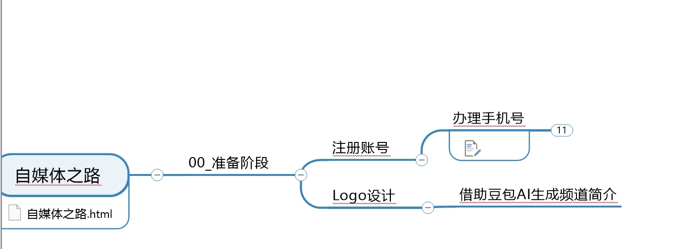
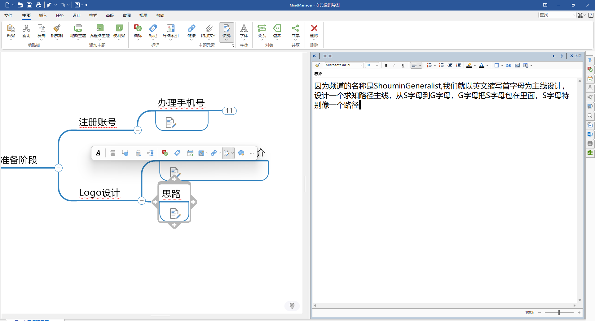

2026-10-21 · 守民通识 · 自媒体之路

# 频道简介与 Logo：把「S 和 G」画成一条路

注册完账号才发现，简介是空的、头像是默认的。这一节从一段文字开始，最后落回一个 Ø100 的圆里——S 的尾巴接上 G 的起点，两个字母连成一条完整的路径。

> **本节数据**： · 13 节 · 2026-10-21 04:58–06:57 · UG NX（Designcenter）

---

## 00 · 缘起：注册完之后，问题自己冒了出来

对应解说词第 1–8 句。

上一节，把各平台的账号注册完了。登录进去一看——账号信息还是空的：要填频道简介，要上传头像。

这两件事本来不在计划里。当时只想先把账号注册下来，结果注册完，问题自己就冒出来了。

所以这一节倒过来做：**先把简介和头像补齐，再往下走。**

### 步骤 1：先给这两件事，在导图里开一个节点

上一节做完，「00_准备阶段」下面还只有「注册账号」一条。这一节的两件事，得先在导图上找个落脚的地方。

在「00_准备阶段」上新建一个子节点，命名「Logo 设计」；再在「Logo 设计」下面新建一个子节点，命名「借助豆包 AI 生成频道简介」。简介和头像，都归到这里。

*04:59（视频 00:50） · 守民通识导图：当场新建的两级节点*

---

## 01 · 频道简介：把手头的零散想法，丢给豆包

对应解说词第 9–14 句。

先理简介。手头的想法是零散的——做过什么、想分享什么、给谁看。不用自己憋成一段话，整堆丢给豆包，让它先梳理，再压缩。

### 步骤 2：把攒下的零散想法一次性贴进去

频道名、行业、二十年研发经历、想做「通识」的初衷——都在导图里。整段贴进对话，让它先梳理结构，再压成一段可用的简介。

*05:00 · 豆包 · 新对话*

### 步骤 3：先梳理定位，再提炼成简介

豆包先给出频道定位——开通目的、个人背景、内容规划——再把上面这一堆，压成一段可以直接用的简介。

*05:00 · 绿框是当时的标注：请把以上文字提炼为「守民通识」自己的频道简介。*

### 步骤 4：存回导图

完整版、短版、超短版，都复制回「借助豆包 AI 生成频道简介」这个节点。以后哪个平台要填，直接从这里拿。

*05:02 · 简介存进导图节点，按长度分版*

> **技巧**
> 简介不用一次写死。先有完整版兜底，再按平台裁长度；以后要改，只改一处，其余复制。

---

## 02 · 头像的想法：让 G 把 S 包在里面

对应解说词第 15–24 句。

简介有了，轮到头像。频道名是 Shoumin Generalist，就拿这两个首字母来搭：S 和 G。

### 步骤 5：先在导图里，把想法写成一句一句话

别急着开软件。先把「长什么样」一条条敲下来：

- 让 G 把 S 包在里面
- S 本身像一条路，从尾端走上去，接到 G 的起点
- 两个字母首尾相连，就是一条完整的路径
- 路上放一个小人，从小走到老，头上顶着一颗知识球
- 球从一个点，慢慢聚成一颗

*05:04 · 想法以短句的形式，挂在「思路」节点下*

### 步骤 6：收成一句设计主线

最后压成一句：「以英文缩写首字母 SG 为主线设计（以人为本，以求知路径为主线）」。这句话后来成了判断每一根线该不该留的标准。

*05:07 · 思路节点里的便签，主线写在里面*

> **技巧**
> 每个设计决定，都留一句人话解释。画到一半卡住的时候，回去读那句话，比盯着屏幕有用。

---

## 03 · 先交给 AI：试了几款工具，方向都不太对

对应解说词第 25–30 句。

想法有了，先别自己动手——交给 AI 试一版。

### 步骤 7：把需求一次说全

提示词里把用途、形态、平台一次交代清楚：频道用的头像，要能兼顾抖音、头条、B站等各平台的展示尺寸。

*05:15 · WorkBuddy · 生成头像*

### 步骤 8：第一版出来了

深蓝底、金色笔画，G 把 S 兜在里侧，中间一颗球。方向是对的，但笔画的粗细、开口的大小、球的位置，全都是「生成」出来的，不是「设定」出来的——想动一个数，动不了。

*05:21 · 第一版结果，右下角带「AI 生成」水印*

### 步骤 9：换几款工具，越走越远

又换了几款 AI 工具，效果都不太理想。风格飘、结构散，改不动。

*05:23 · 另一款工具的输出*

### 步骤 10：那就自己画

结论写回导图：「使用 NX 设计」。平时做机械设计，用的就是 UG 软件；这次画 logo，也用它。

*05:23 · 导图里补上结论节点*

> **坑 · 可控性**
> AI 给的是「成品感」，不是「可控性」。要让 S 的尾巴精确落在圆心上、让每段圆弧的半径可查，得回到参数化软件里——一根线一根线地画。

---

## 04 · 起框：先画一个 Ø100 的圆，把想法关进去

对应解说词第 31–38 句。

打开 UG。第一步不是画线，是建文件、定边界。

### 步骤 11：打开 UG

这台机器上装的是 Designcenter 封装版，界面就是 NX。

*05:24 · Designcenter 启动*

### 步骤 12：新建 → 选模板 → 命名 logo261021

先新建一个 **tmplogo** 文件夹，把这次的东西都收进去；文件命名为 **logo261021**。规则很简单：用途 + 日期，以后翻出来一眼能认。

*05:27 · 模型模板 → 命名*

### 步骤 13：新建草图，画一个圆，直径改成 100

进入草图，先画一个圆作为外形轮廓，把直径改成 100——外轮廓大概十厘米。接下来所有的设计，都在这个圆里面完成。

*05:28 · Ø100*

> **技巧 · 为什么先画圆**
> 这一步定的是边界，不是造型。圆是唯一没有方向的边界——S 和 G 怎么转、怎么盖，最后都要落回这个圆里。边界定了，后面每条线的位置、每段圆弧的半径才有参照，也才有了「改一个数就能改全局」的可能。

---

## 05 · 勾骨架：先摆关系，再谈形准

对应解说词第 37–51 句。

圆画好了，先不追求形准，先把两个字母的「关系」摆出来。

### 步骤 14：G 的基准——圆的上方一条横线

先画出 G 字母的基准形状——在圆的上方画一条横线。

*05:29 · Line*

### 步骤 15：S 的轮廓——样条曲线，点四个点

选样条曲线，点四个控制点，把 S 的轮廓勾出来。形不准，但走势对。

*05:29 · Studio Spline · 四个控制点*

### 步骤 16：中心横线，剪断，骨架成型

再在中心画一条横线——这样 S 和 G 的关系就出来了。把横线剪断，草图的大致想法就能看到了。

然后顺着 S 的路径走一遍：从 S 的尾端倒着「写」S，一路往上，让 S 的起点接上 G 的起始段——两个字母就组成了一条完整的路径。这里有个尖角，切掉，用一条斜线连过去。

*05:30 · 骨架：圆 + S 走势 + G 基准线*

> **坑 · 「倒着写」是关键**
> 如果 S 从起笔处往下走，末端就和 G 的起点对不上——两个字母会变成并排的两个图形，而不是一条连续的路径。方向反一次，整张图的逻辑就变了。

---

## 06 · 曲线文字：把 S 写进路径里

对应解说词第 52–73 句。

骨架只是个意思。真正要的，是精确的字母形状——UG 的曲线文字，能把字体直接「贴」到一条曲线上。

### 步骤 17：曲线 → 文字 → 在曲线上创建文字

*05:31 · Text · 类型选「在曲线上」*

### 步骤 18：咦，选错了——把过滤器改成「单条曲线」

点一下，选中的是一串曲线。把选择过滤器改成「单条曲线」再点。方向选 Y，位置放到居中，参数 50%。

*05:32 · 参数 53.5，字体还是微软雅黑*

### 步骤 19：曲线太短，只能移到最左边

这时发现一个问题：这条曲线最多只能移到最左边，就动不了了。因为它是**基准曲线**——0–100% 指的是曲线长度上的位置，不是到圆心的距离。

*05:33 · Extend · 延长到与外圆相交*

### 步骤 20：S 落位——延长曲线，换等宽字体

中键确认退出草图，重新进入，用「延伸」把曲线拉到跟外圆相交——曲线长度就等于外圆直径了。参数设到 50%，正好是圆心，S 的中心也就落在了圆心。

长度改成 40。然后把字体换掉：微软雅黑不是等宽字体，换成等宽的 Arial。

*05:34 · S 落位：Arial、参数 50%、长度 40*

> **坑 · 这一节的三个坎**
> 1. **选择过滤器**——默认会捕捉，一选就选到旁边的曲线。把过滤器切成「单条曲线」再点，命中率才稳。
> 2. **基准曲线的百分比**——0–100% 是「沿曲线长度的位置」，不是「到圆心的距离」。曲线比外圆短，中点就够不到圆心。先把曲线延长到与外圆相交，50% 才正好落在圆心。
> 3. **等宽字体**——微软雅黑不是等宽。S 和 G 用同一个字号，笔画粗细却不一样。换成 Arial。

---

## 07 · 第二个字母：G 落位，两条文字曲线

对应解说词第 74–82 句。

S 字母完成了。再添加一个文字，画 G。

### 步骤 21：G 的参数——Arial、50%、总高度 100

字体同样改成 Arial，参数设到 50%，总高度 100，再调偏移，让 G 落在轮廓中心。

*05:37 · G：Arial、参数 50%、高度 100*

> **坑 · G 跑到背面去了**
> 曲线有方向。方向反了，G 会贴到反向的平面上，看起来「消失」在背后。把曲线方向反过来，让它和 S 在同一平面。

### 步骤 22：隐藏草图，现在有两条文字曲线

*05:38 · S 与 G，两条文字曲线*

---

## 08 · 提取中心线：投影进来，再偏置到中间

对应解说词第 83–95 句。

文字曲线是两条「带宽」的字母轮廓。我们真正要画的，是它们的中心线——也就是路径本身。

### 步骤 23：新建草图，把 S 和 G 投影进来

*05:39 · Project Curve*

### 步骤 24：量 S 的中空宽度——6.4 → 偏置 3.2

量一下 S 的中空宽度，是 6.4。那就偏置 3.2，正好到中间。

*05:41 · Offset Curve · 3.2*

### 步骤 25：量 G 的中空宽度——12.4 → 偏置 6.4

G 的中空宽 12.4，偏置 6.4 到中心。方向反一下，全选，确认。

*05:42 · Rapid Dimension*

### 步骤 26：中心曲线都提取出来了

把原来的曲线隐藏掉。现在留下的，就是一条带宽一致的中心路径。

*05:43 · 中心线提取完成*

> **技巧 · 勾掉「创建尺寸」**
> 偏置时把「创建尺寸」勾掉，偏出来的曲线就和原曲线解除了关联，可以单独编辑。不勾的话，原曲线一改，中心线跟着跑。

---

## 09 · 和样条告别：选中一看，满屏控制点

对应解说词第 96–114 句。

中心线出来了，但选中一看——上面有很多控制点。说明它们是样条曲线，不是直线。

### 步骤 27：控制点暴露了它的身份

样条后面很难控制：改一个点，整段都在动。所以要删掉，换成直线，或者圆弧。

*05:43 · 满屏控制点 = 样条*

### 步骤 28：用三点画圆，一段一段拟合

很长的样条，用多段圆弧去拟合。选三点画圆命令，一段一段描上去。

*05:46 · Three Point Circle*

### 步骤 29：按 X 修剪，反复几轮

拟合好一段，按 X 打开修剪，把多余的剪掉，然后继续画下一段。不需要的曲线，选中按 Delete 删除。

*05:51 · Trim*

> **坑 · 三点画圆会自己捕捉**
> 三点画圆默认会捕捉点。一捕捉，就自动加了约束，画出来的圆不是你要的那个。**取消捕捉的办法是：按住 Alt 再画。**

> **技巧 · 记住这个循环**
> 三点画圆（按住 Alt）→ 按 X 修剪 → Delete 删掉多余样条。一段一段往下推，别想着一次画完。

---

## 10 · G 段收口：相切、补圆弧、一次拟合

对应解说词第 115–119 句。

G 字母这部分，差不多完成了。

### 步骤 30：相近的点，改成相切

把相邻两段改成相切约束，接缝才光顺，不会出现折角。

*05:59 · Make Tangent*

### 步骤 31：有几处没连上，用圆弧接起来

连第一段，再连第二段；有问题的部分，删掉重画。

*06:07 · Arc · R=32.4*

### 步骤 32：剩下的样条，交给拟合公差

不用一段段描——用提取/优化命令把样条一次性转成直线和圆弧，弹出「选择要逼近的曲线」时给一个公差：公差越小越贴，段数也越多。

*06:26 · Select curves to approximate*

---

## 11 · S 段再来：同一套手法，这次先加约束

对应解说词第 120–129 句。

开始处理 S 字母。再检查一遍，还有没有没处理的样条。

### 步骤 33：清理干净，再更新草图

把残留的样条剪掉、删掉，更新草图，确认当前状态是干净的。

*06:41 · Trim / Update Sketch*

### 步骤 34：最后一段不能动，先加固定约束

后面要用圆弧去贴它，它就不能跑——先固定住。

*06:45 · Fix Curve*

### 步骤 35：相近点改相切，S 曲线整段拟合

用同样的方法往下推：三点画圆、按住 Alt 取消捕捉、按 X 修剪。最后把原来的 S 样条删掉。

*06:48 · Make Tangent*

> **坑 · S 段捕捉更凶**
> S 段的曲率变化比 G 大，捕捉更容易把点咬到别的线上。按住 Alt 这一条，在这一段要一直记着。

---

## 12 · 钉死外形：标好尺寸，整体外形就定了

对应解说词第 130–134 句。

这里画一条斜线，连上 S 的尾端和 G 的起始端——两个字母，这才真正接上。

### 步骤 36：标注尺寸，确认相对位置

斜线接上之后，把所有关键间距标出来。尺寸标全，整体外形就确定了——以后任何一个数改动，整条路径都会跟着走。

*06:52 · Rapid Dimension*

### 步骤 37：把所有直线连接的地方，都改成圆弧

这样整条路径才是光顺的。到这里，两条曲线拼成了一条路径。

*06:57 · 最终草图 · 一条完整的路径*

---

## 尾声

> 这一步本来不在计划里。
> 往下走一步，才知道下一步需要扩展使用什么知识。

---

***

| 平台 | 链接 |
| --- | --- |
| 今日抖音发布 | [从零开始做自媒体_Day2_账户信息Logo设计](https://www.douyin.com/video/7699722787316976930) |
| 今日头条发布 | [自媒体之路 Day2：先补简介和头像，用 UG 把 S 和 G 画成一条路径](https://www.toutiao.com/article/7699276957896163876) |
| 今日B站发布 | [从零开始自媒体之路_Day2_用UGNX设计 Logo](https://www.bilibili.com/video/BV1t3n46GELc) |
| 今日Youtube发布 | [自媒体之路 Day2 Logo设计](https://youtu.be/PtXz_rtkf28) |
| CloudFlare站点 | [CloudFlare站点](https://shoumingeneralist.pages.dev/) |
| GitHub站点 | [GitHub站点](https://shoumingeneralist.github.io/) |
| 纯文教程 | [Day2：频道简介及Logo设计20261021（纯文）](/selfmediapath/日更/纯文教程/day2频道简介及logo设计20261021纯文/) |

***
