2026-10-24 · 守民通识 · 自媒体之路

# Logo 路径： 给一条路径装上厚度和方向

上一节画完的，是一条草图里的路径——有宽度、尺寸也都对，但它还躺在二维里：没有厚度，分不出层，也看不出往哪走。这一节把它变成实体，再一层一层往上加：拉伸给体量，凸点给节奏，上色给分区，箭头给方向。

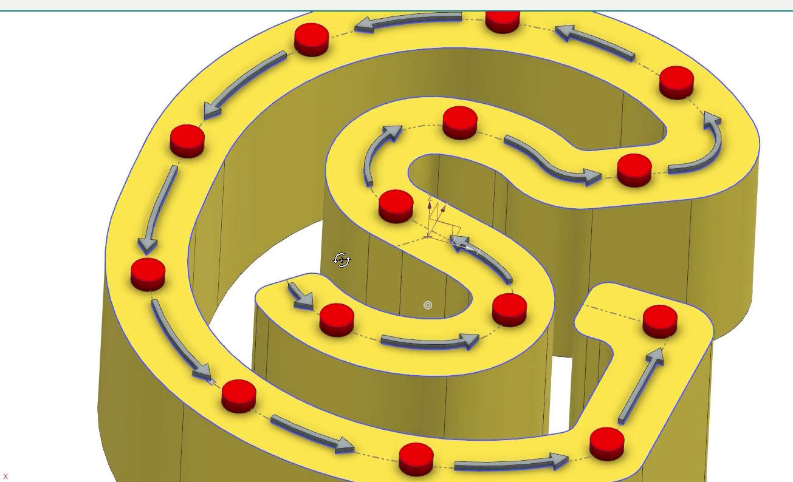

> **本节数据**：10 节 · 23 个步骤 · 24 帧实录 + 4 张参数特写 · 2026-10-24 18:39–19:24 · UG NX（Designcenter）

---

## 00 · 缘起：退出草图，先把这条路径看清楚

对应解说词第 1–12 句。

上一节画出来的不是一根线，是一条有宽度的路径：两条平行的轮廓并排走，围出一条带子，从 S 的尾端一直通到 G 的开口处。带子正中间还藏着一条**中心曲线**，当时是隐藏的——后面布点、加凸点、排箭头，全都要沿它走。所以这一节先做两件事：退出来看清这条路径怎么走；再进去把中心曲线显示出来，认它作基准，剩下的碎线剪掉。

### 步骤 1：Ctrl+Q 退出草图，先看这条路径

退出草图任务环境，整条路径就露出来了：从 S 的尾端出发，一路向上，接上 G 的起始段，最后收在 G 的开口处。看到的不是一根线——两条轮廓并排走，中间那点宽度，才是这条路径本身。

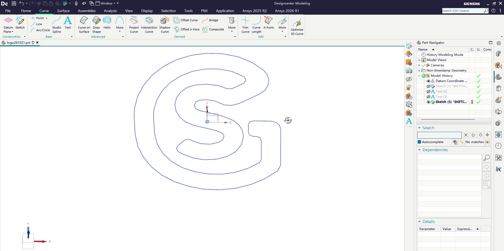

*00:15 · 退出草图，整条路径一目了然*

### 步骤 2：把中心曲线显示出来，认它作基准

路有了，还缺一条基准线。路径正中间有一条**中心曲线**，当时是隐藏的——双击进草图，把它显示出来。后面布点、排箭头全沿它走，它偏一点，一圈东西跟着偏。中心曲线定住之后，剩下不参与后续的碎线按 **T** 修剪掉，再 Ctrl+Q 退出来。

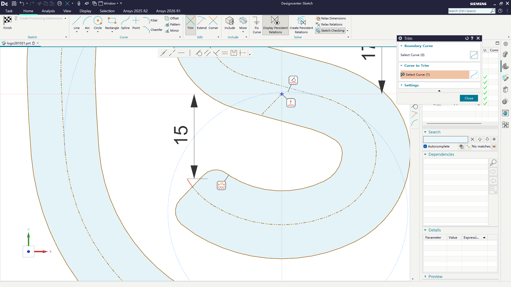

*00:44 · 按 T 修剪，去掉不参与后续的碎线*

> **技巧**
> 后面做凸点、加箭头，全部要沿这条中心曲线走。它要是断了一段，或者混进别的线，点集就会落在错的位置，事后很难回查是哪一段出的问题。**先把基准线认准，再动手。**

---

## 01 · 14 个途经点：凸起的位置，不能靠手点

对应解说词第 13–27 句。

这条路径后面要长出一圈凸起。14 个点得均匀分布，还得避开两端——手动一个个点，既不准也改不动。

### 步骤 3：点集命令，先选中整条路径

类型选 **Curve Points**，子类型选 **Equal Arc Length**（等弧长），然后把路径上的全部曲线选进来。

「等弧长」这三个字是关键：它不是沿参数均匀切分，而是沿着曲线走过的**长度**均匀切分。曲线疏密不均时，只有按长度分，落点才看起来是匀的。

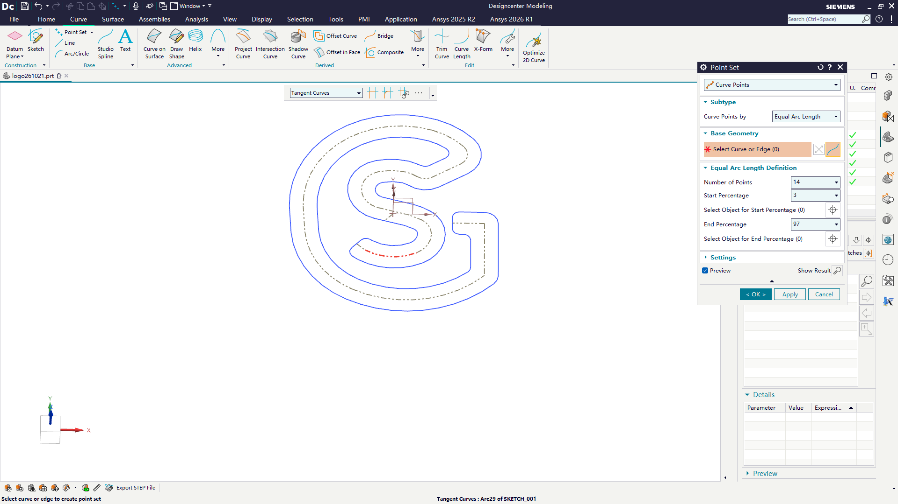

*01:14 · Curve Points → Equal Arc Length*

### 步骤 4：数量 14，一个不多一个不少

Number of Points 填 **14**。

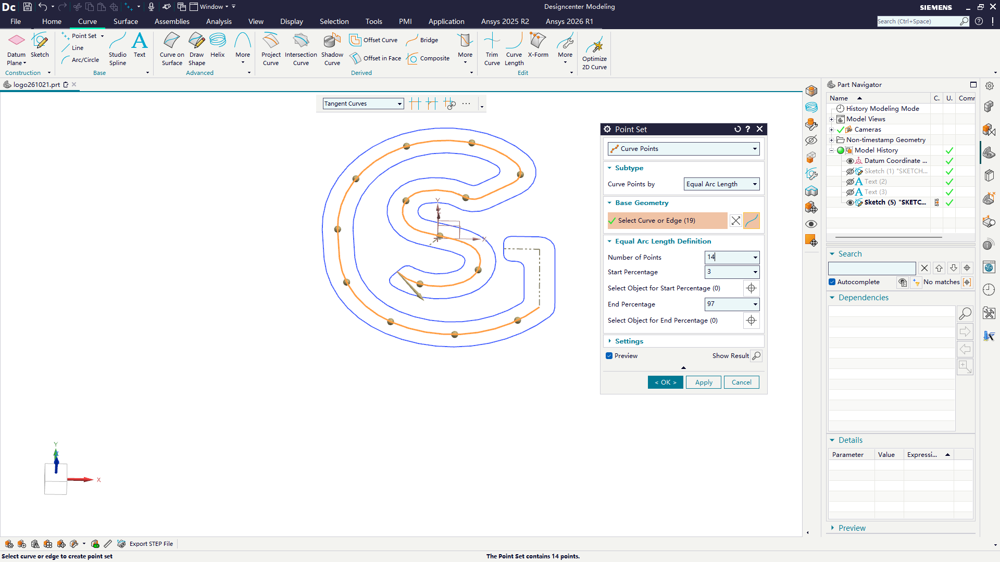

*01:10 · 14 个点，沿路径均匀落下*

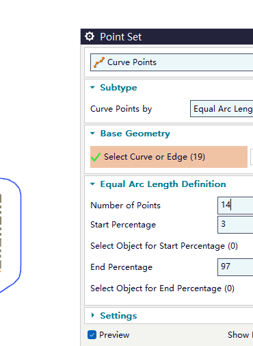

*参数特写 · 14 个点 · 起始 3% · 终点 97%*

### 步骤 5：起始 3%，终点 97%

Start Percentage 填 **3**，End Percentage 填 **97**。两端各留一点间距，14 个点就落在一条「收进去」的路径上。

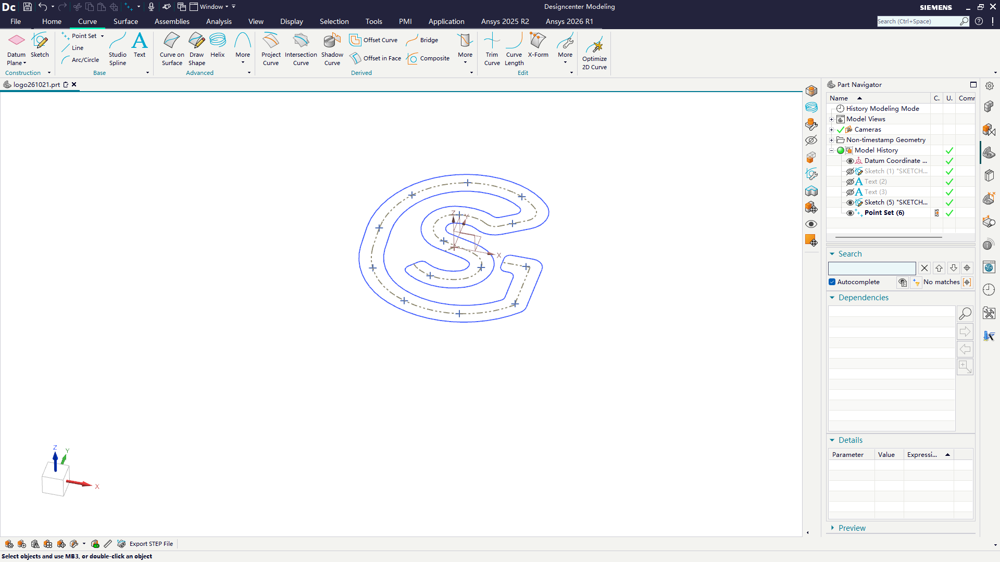

*01:53 · 大致形状出来了*

> **坑**
> **别用 0% 到 100%。**起始填 0，第一个点就落在路径最开端——凸起会咬在端头上，后面加箭头时一点余量都没有。两端各让 3%，凸起才落在「体面」的位置。
> 14 这个数也是试出来的：太密，凸起挤在一起糊成一片；太疏，整条路径显得空。

---

## 02 · 先给厚度：路径现在只有宽度，先给它厚度

对应解说词第 28–41 句。

点定好了，可这条路径还平躺在草图平面上——没有厚度，谈不上凸起，也谈不上刻痕。

### 步骤 6：按 X 拉伸，先把过滤器换掉

按 **X** 调出 Extrude，也可以从菜单里找。这时候默认只选中了单条曲线——要的是整个草图，所以在顶部过滤器里改成 **Feature Curves（特征曲线）**。

特征，指的就是我们画的那个草图。改完过滤器，一次就能把整条路径选进来。

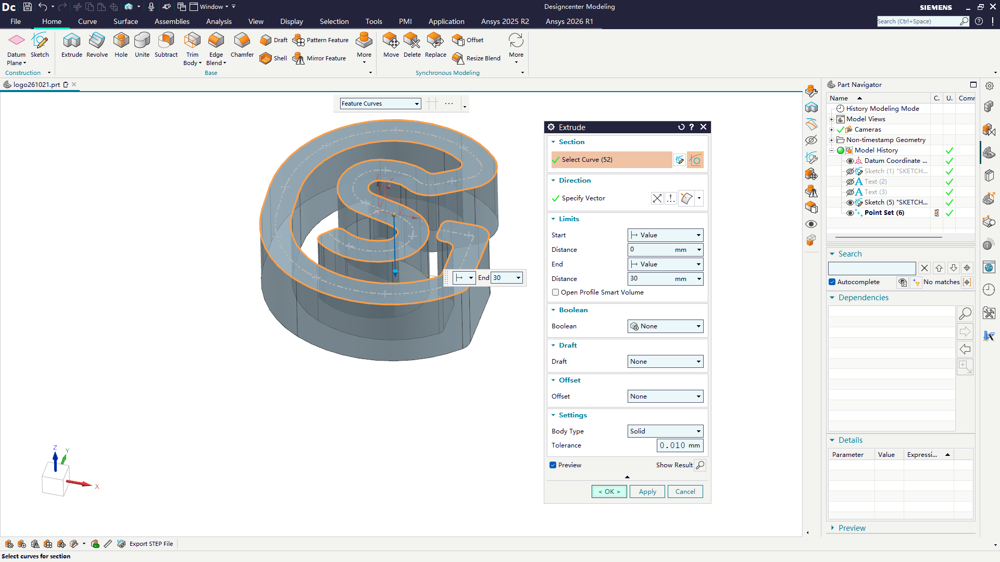

*02:36 · 过滤器 Feature Curves · 距离 30*

> **技巧**
> **30 不是最终厚度。**它只是先给一个够用的体量，好让你看清凸起长在哪儿、箭头压在哪面。真正的尺寸是后面的事——先有东西可看，再谈好不好看。

---

## 03 · 凸起：用「孔」命令，做出一圈凸起

对应解说词第 42–69 句。

这一节最反直觉的一步：凸起不是「长」出来的，是拿**打孔**的命令反过来做出来的。

### 步骤 7：孔命令，从导航栏里选点集特性

打开 **Hole**，点 Position。这里要把 14 个点全选中——逐个点太麻烦，直接从右侧部件导航器里点中 **Point Set** 那个特征，14 个点一次全中。

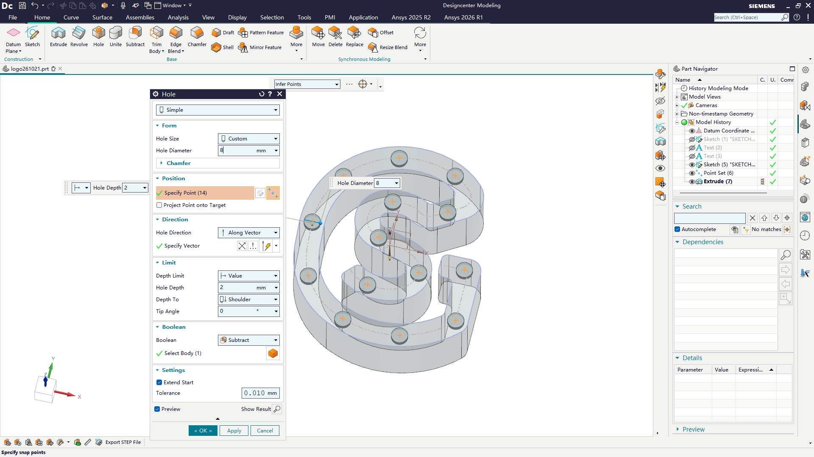

*03:15 · Specify Point (14)，一次全中*

### 步骤 8：直径 5，深度 2

默认直径偏大，改成 **5**；深度 **2**。14 个凸起，一次全出来。

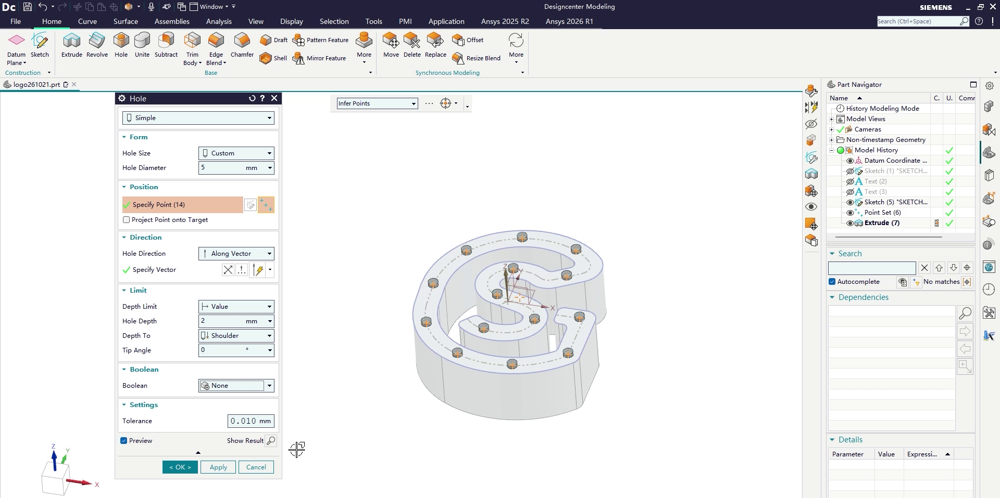

*04:08 · 直径 5 / 深度 2 / 布尔 None*

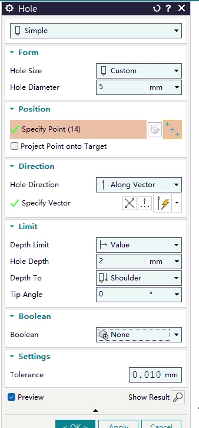

*参数特写 · 直径 5 · 深度 2 · 布尔 None*

### 步骤 9：方向改向上，布尔改「无」

孔天生是「求差、向下切除」。这里要的是凸出来，所以方向反过来改成向上；再把布尔运算改成 **None**——不切也不并，让它们各自成为独立实体。

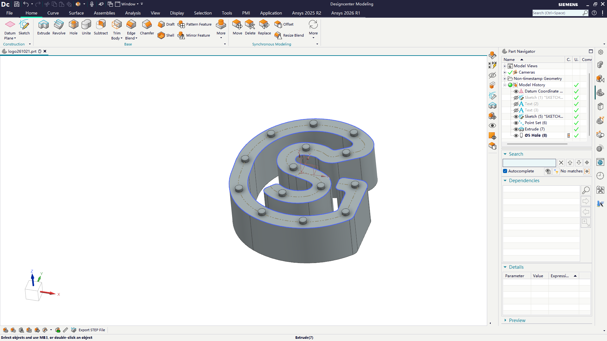

*04:27 · 14 个独立实体，还没合并*

> **坑**
> **为什么偏要「不执行布尔」？**不是洁癖。下一步要按实体分别上色：面是黄的、点是红的。一旦布尔合并成一个体，颜色就再也分不开了——只能整体一个色。
> 顺序是死的：**先分开，再上色，最后才谈合并。**

---

## 04 · 上色分区：黄的是面，红的是点

对应解说词第 70–79 句。

上色不是为了好看。这种「带子上有一串凸点」的模型，线框模式下根本看不出哪是面、哪是点，只有靠颜色才分得清。

### 步骤 10：Ctrl+J 编辑显示，主体设黄

选中主体实体，按 **Ctrl+J** 打开「编辑显示」，指定黄色。

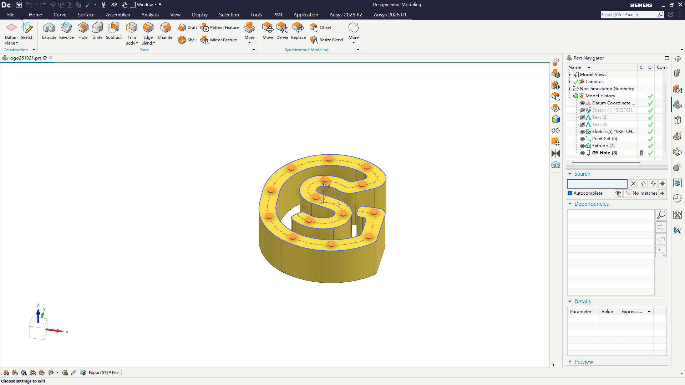

*04:53 · 主体 → 黄色*

### 步骤 11：凸起点设红

再选中那 14 个凸起实体，同样 Ctrl+J，这次给红色。

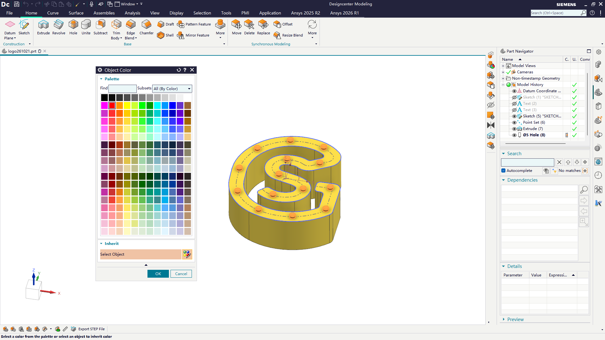

*05:03 · 凸起 → 红色*

### 步骤 12：带凸点的路径模型，建好了

换个角度转一下：黄色带体上，14 个红点沿着路径分布，虚线是点集的中心线，还留在上面当参考。

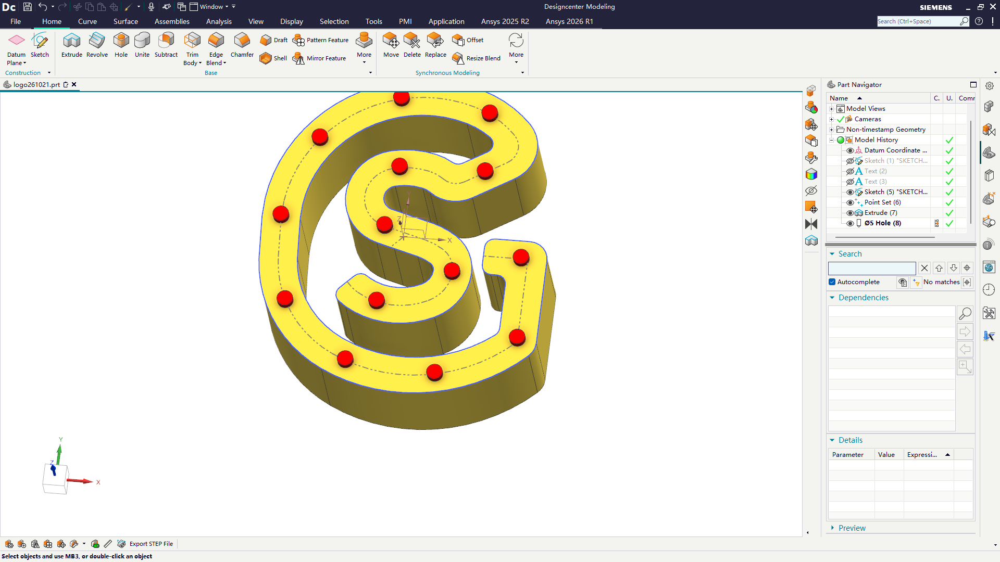

*05:09 · 带凸点的路径模型*

---

## 05 · 箭头样板：先画一个箭头，画准了再复制

对应解说词第 80–103 句。

方向信息要用箭头表达。箭头是**单独一张草图**，不是在带体上刻——先在新草图里把第一个箭头做准。

### 步骤 13：新建草图，把路径包含进来

另起一张草图，用 **Include（包含）**命令把路径曲线引进来，当作画箭头时的参照。

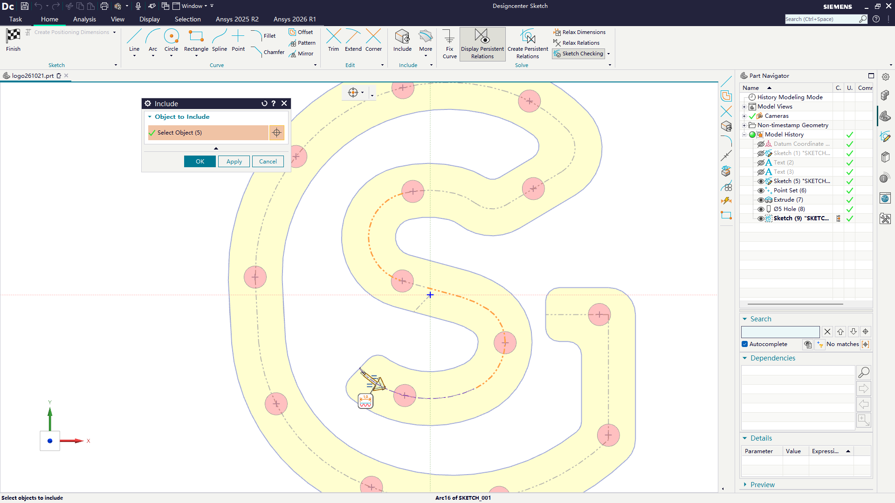

*05:42 · Include：把路径引进来做参照*

### 步骤 14：沿路径画直线，偏置 0.8

先捕捉到路径曲线，画一根直线当箭头的边；再用 **Offset Curve** 偏置出另一侧，距离先给 **0.8**。

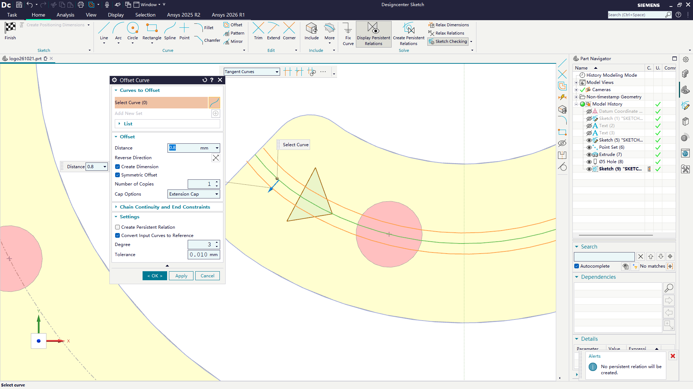

*06:12 · Distance 0.8 · 对称偏置*

### 步骤 15：修剪、垂直约束、长度 2.8

按 **T** 修剪掉多余的线段；给箭头线与路径线加**垂直约束**；箭头端直线长度定到 **2.8**；两条边再加一个**等长约束**，箭头的形状就出来了。

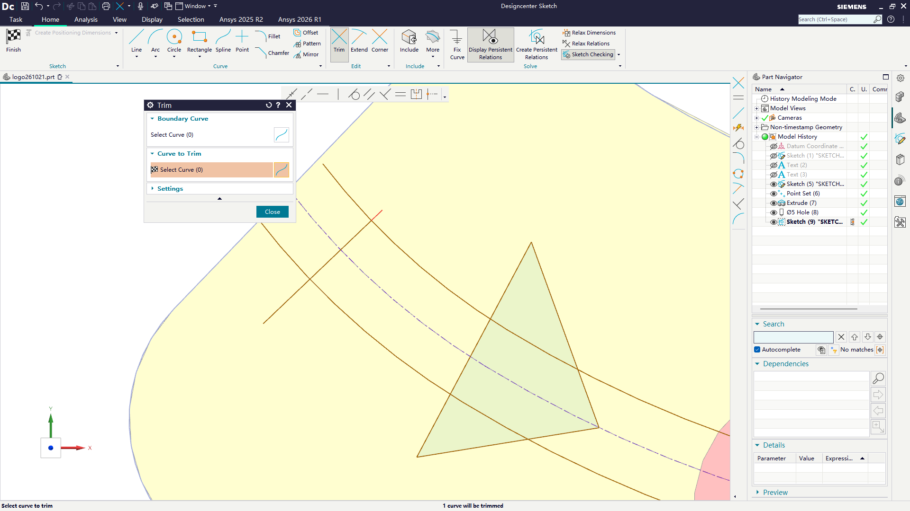

*06:29 · T 修剪，削出箭头*

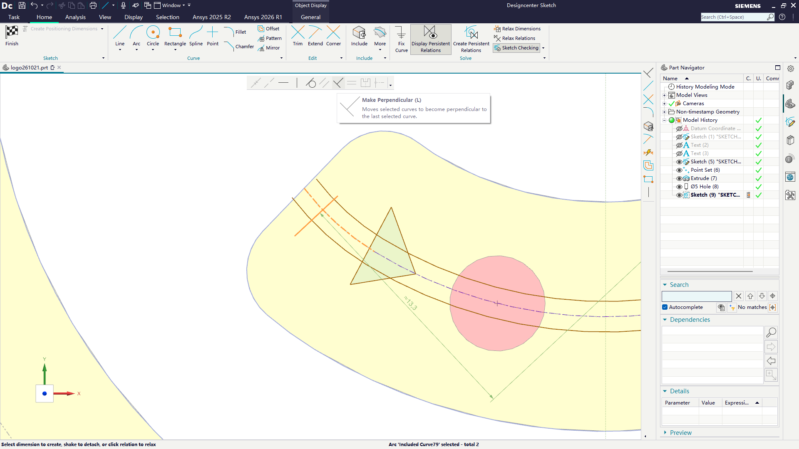

*07:48 · 等长 + 垂直，箭头成型*

> **坑**
> **0.8 偏大了，别硬扛。**第一遍偏置出来的箭头明显偏宽，是靠尺寸约束把长度重新压回 2.8 才对的。偏置只是快速搭个形，**真尺寸永远靠约束定**——先搭形再改数，比一开始就算准快得多。

---

## 06 · 对称偏置：一次偏置，出两条边

对应解说词第 104–115 句。

箭头要沿整条路径铺开，但每段箭头的参照线不是同一条。先把所有路径线包含进来，再一次偏置出对称的两侧。

### 步骤 16：包含全部路径线，过滤器改「筛选曲线」

用 Include 把所有路径线都引进来。这时要把选择菜单的过滤器改成 **Curve**——不然会误选到点上。

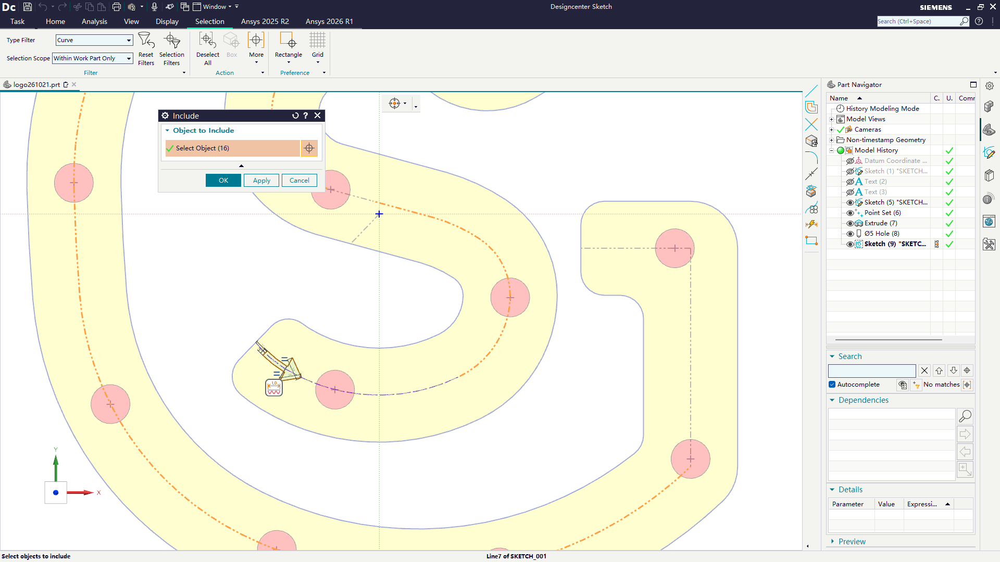

*08:18 · 过滤器改 Curve，避免误选点*

### 步骤 17：偏置曲线 0.4，勾「对称偏置」

回主页菜单找 **Offset Curve**，选中后方的路径线段，距离填 **0.4**，勾上 **Symmetric Offset**——一次出对称的两条，箭头两侧的边界就有了。

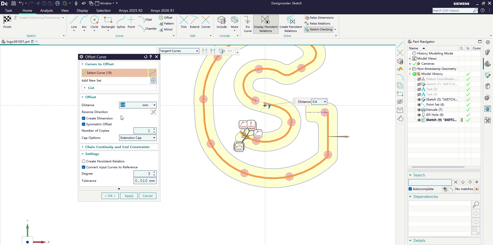

*09:00 · Distance 0.4 · Symmetric Offset*

---

## 07 · 变成一个参数：把 2.8 变成一个参数

对应解说词第 116–132 句。

同一套箭头尺寸，后面要在十几个地方复用。写死数字的话，改一次就得改十几处—— **把尺寸变成参数**，是一处改、处处改。

### 步骤 18：Ctrl+E 调出参数管理器，定义 ARROWHEAD

按 **Ctrl+E** 打开 Expressions，新建一个参数，名字 **ARROWHEAD**，数值 **2.8**，单位 mm。

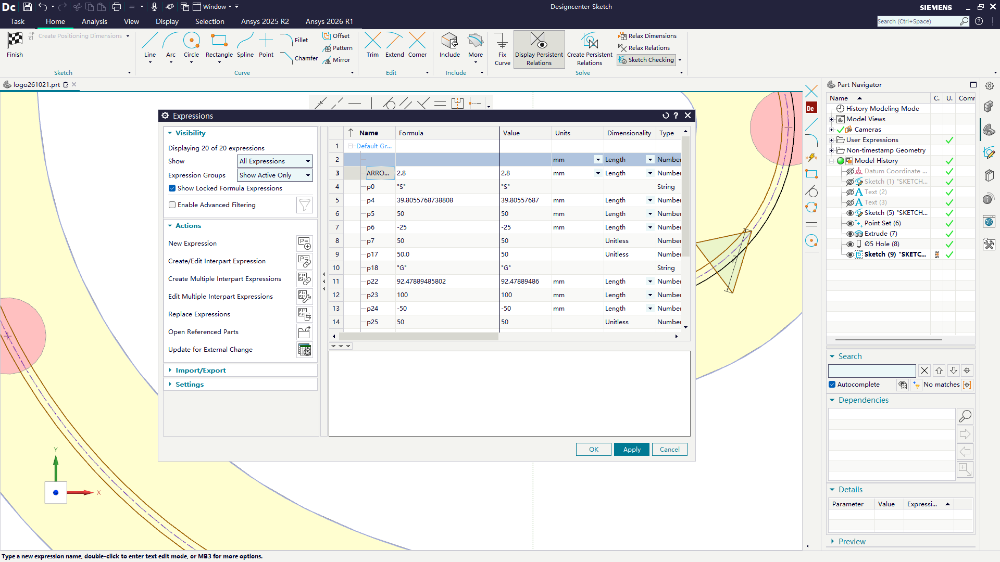

*10:19 · ARROWHEAD = 2.8 mm*

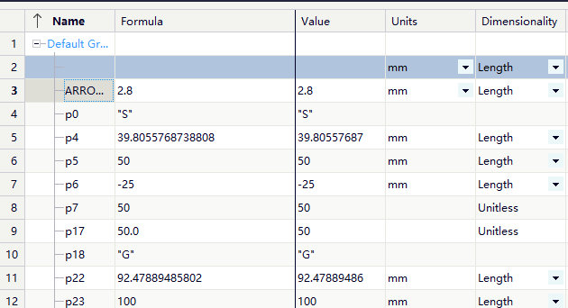

*参数特写 · 第 3 行 · Formula 2.8 · 单位 mm*

### 步骤 19：所有箭头尺寸，都指向这个参数

接下来每个箭头的长度尺寸，都不再填数字，直接填 **ARROWHEAD**。图上会显示成 **p131=ARROWHEAD** 这样——一眼能看出它是个变量，不是死数。

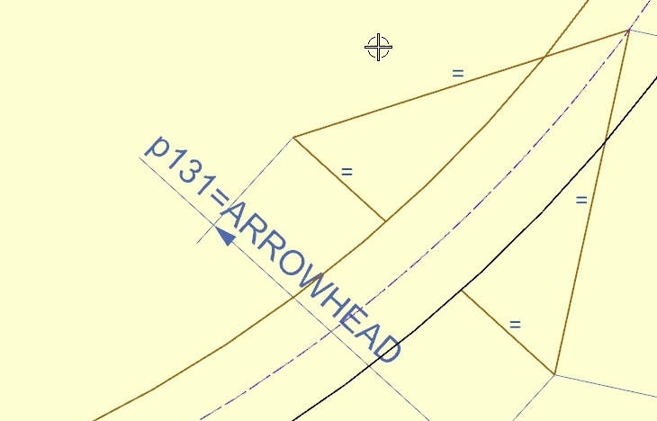

*11:23 · 尺寸标注直接写成 p131=ARROWHEAD*

> **技巧**
> 参数化省下的不是打字时间，是**返工的次数**。等画到第七八个箭头发现「还是长了点」，改一次参数就够了——不用回头一个个找。

---

## 08 · 重复一圈：同样的动作，重复到一整圈

对应解说词第 133–144 句。

剩下的没有新方法，只有重复：画线、偏置、修剪、加约束、再修剪。这一段占了录制里最长的时间。

### 步骤 20：画下一段箭头，按住 Alt 取消捕捉

每画一根线，都可能是从上一个箭头的端点起手。位置吸错了，整个箭头就歪了。

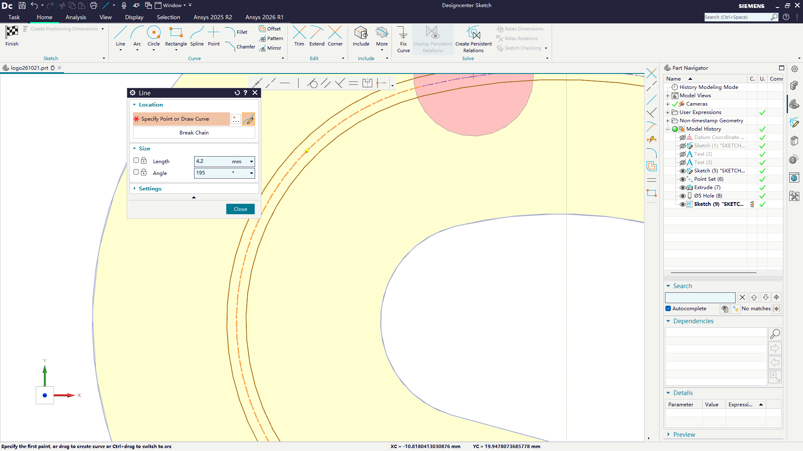

*11:41 · 继续下一段箭头*

> **坑**
> **Alt 键是临时取消捕捉。**画箭头时默认会吸附到邻近的点或线上，很容易吸到一个「看起来很近」但其实错的点。按住 Alt 再点，捕捉就临时失效——这个键在密集绘图时几乎每一步都要用。

### 步骤 21：Ctrl+Q 退出，回头检查多余线段

全部画完，退出草图。这时能整体看到箭头的效果了——然后再检查一遍有没有漏剪的线段，发现就双击进去，按 **T** 补剪，再退出来。

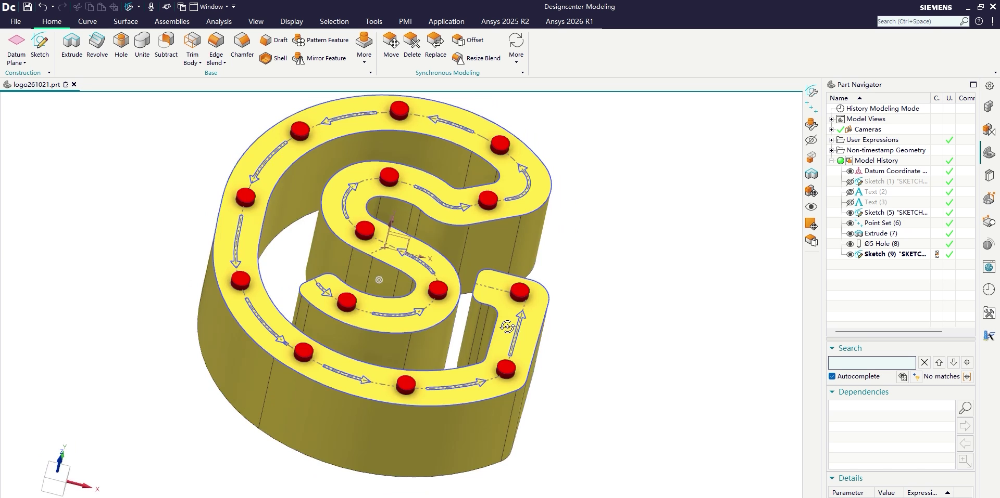

*15:00 · 一圈箭头画完，退出草图看整体*

---

## 09 · 最后一次拉伸：高度只给 1，因为它是刻痕

对应解说词第 145–152 句。

箭头还是平面草图，最后一步把它拉起来——但只拉 1mm。

### 步骤 22：选中箭头草图，按 X 拉伸，高度 1

选中草图，按 **X**，End Distance 填 **1**，布尔还是 None。预览确认没问题就确定。

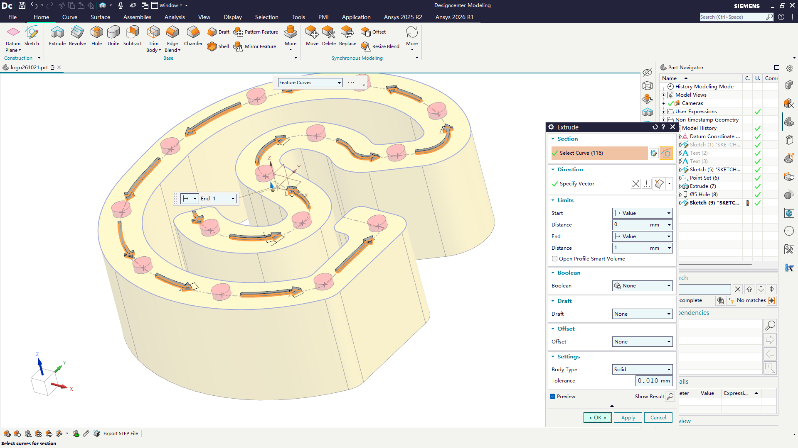

*15:17 · End Distance 1 mm*

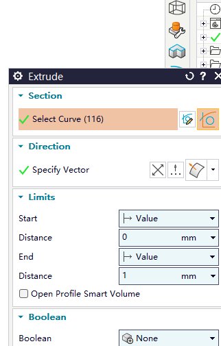

*参数特写 · End Distance 1 · Boolean None*

> **技巧**
> **为什么只给 1mm？**箭头不是独立零件，是带子表面的一道**刻痕**。给 1mm 刚好能看出方向，又不会把整体撑厚。这也解释了为什么前面要先上色——如果箭头和带体一个颜色、一个厚度，转个角度看就什么都看不出来了。

### 步骤 23：路径部分，完成了

黄的面、红的点、灰的箭头。一条路径带上的三件事——**是什么、有几个落脚点、往哪走**——到这里全在模型上了。

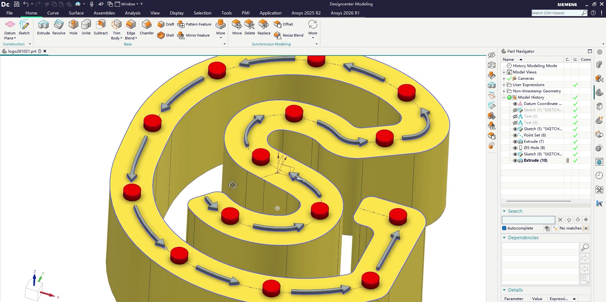

*15:35 · Logo 的路径部分完成*

---

## 尾声

> 这一节没画一个新造型，全是往上加。
> 加一层，就多一个能改的地方。

| 平台 | 链接 |
| --- | --- |
| 今日抖音发布 | [从零开始做自媒体_Day3：Logo之路径设计](https://www.douyin.com/video/7700532884842614059) |
| 今日头条发布 | [自媒体之路--Day3：给Logo路径装上厚度和方向](https://www.toutiao.com/article/7700526993065951744) |
| 今日B站发布 | [从零开始自媒体之路_Day3_Logo之路径设计](https://www.bilibili.com/video/BV1c8H56vEN9) |
| 今日Youtube发布 | [自媒体之路_Day3 logo之路径设计](https://youtu.be/-ArG9ANC_pc) |
| CloudFlare站点 | [CloudFlare站点](https://shoumingeneralist.pages.dev/) |
| GitHub站点 | [GitHub站点](https://shoumingeneralist.github.io/) |
| 纯文教程 | [Day3：Logo路径设计20261024（纯文）](/selfmediapath/日更/纯文教程/day3logo路径设计20261024纯文/) |

***
